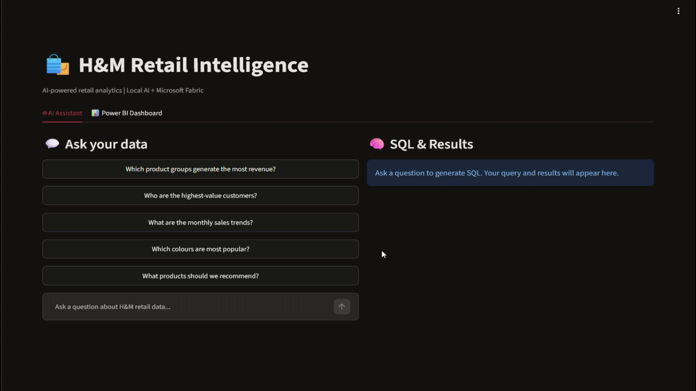

# H&M Sales Analysis – Project Overview

## 1. Objective

The objective of this project is to analyze H&M's sales and customer data from 2018 to 2020 to identify revenue drivers, customer purchasing behavior, and shopping trends. The goal is to transform raw data into actionable business insights and develop a product recommendation approach to support better marketing and sales decisions.

## Dataset

[H&M dataset](https://www.kaggle.com/competitions/h-and-m-personalized-fashion-recommendations/data) Kaggle.

## Setup Guide

For installation instructions and steps to run the local LLM application, see:

[LLM Setup Guide](setup.md)

## Demo

Watch the demo of the LLM application:

## 2. Methodology – What We Did

- **Data Preparation:** Cleaned, transformed, and organized transaction, article, and customer datasets.
- **SQL Analysis:** Used SQL to explore sales performance, product categories, customer demographics, and purchasing behavior.
- **Data Modeling:** Established relationships between transactions, articles, and customers.
- **Power BI Visualization:** Developed an interactive dashboard to present key KPIs, revenue trends, product performance, and customer shopping patterns.
- **Recommendation System:** Calculated product recommendation scores and ranked products to generate a recommendation table.
- **Local LLM Integration:** Integrated a locally running LLM application to enable AI-powered interaction with analytical results.

## 3. Key Findings

- **Top Revenue Department:** Trousers generated the highest revenue throughout the analysis period.
- **Popular Product Categories:** Garment categories accounted for the majority of customer purchases.
- **Average Purchase Quantity:** Each customer purchased approximately 6.7 items between 2018 and 2020.
- **Customer Demographics:** The average customer age was approximately 36 years.
- **Shopping Patterns:** June recorded the highest shopping activity, with Saturday being the most popular shopping day.
- **Product Recommendations:** Products were ranked based on recommendation scores to identify relevant suggestions.

## 4. Business Recommendations

- Prioritize high-revenue departments in inventory and promotional planning.
- Focus marketing campaigns on popular garment categories.
- Encourage larger purchases through cross-selling and product bundles.
- Develop targeted campaigns for the core customer demographic.
- Schedule promotions around peak shopping periods.
- Leverage personalized product recommendations to improve customer engagement and sales.

## 5. Conclusion

This project demonstrates how SQL, data modeling, and Power BI can transform raw retail data into meaningful business insights. The findings support data-driven decisions in sales optimization, marketing, inventory planning, and personalized product recommendations.
